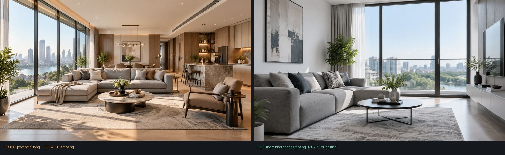

# Unrender

**Ảnh AI hết ám vàng.**

Skill cho Claude Code viết prompt tạo ảnh trông như chụp bằng máy ảnh thật, không
như ảnh render.



Cùng một chủ thể, cùng một công cụ. Bên trái là prompt thường. Bên phải là prompt
có khối chống ám vàng.

## Vấn đề

Bạn gõ "phòng khách căn hộ hiện đại" và nhận về một căn phòng ám vàng. Tường
trắng ra màu kem, gỗ ngả cam, nắng như lúc 5 giờ chiều dù bạn không hề nói vậy.

Mô hình học từ kho ảnh quảng cáo nội thất, mà loại ảnh đó gần như luôn được chỉnh
ấm cho "sang". Nên nó coi ấm là mặc định. Không cấm rõ thì nó cứ làm ấm.

## Cách sửa, dùng được ngay

Dán khối này vào cuối mọi prompt:

```
Cân bằng trắng trung tính 5500K, ánh sáng ban ngày trời quang.
Màu trắng phải ra trắng, màu xám phải ra xám trung tính.
KHÔNG ám vàng, KHÔNG ám cam, KHÔNG tông ấm.
Không đèn sợi đốt, không giờ vàng, không hoàng hôn.
```

Bản tiếng Anh:

```
Neutral white balance 5500K, clear daylight.
Whites must read as true white, grays as neutral gray.
NO yellow cast, NO orange tint, NO warm grade.
No tungsten light, no golden hour, no sunset.
```

## Đo được bao nhiêu

Thử trên ChatGPT image, cùng chủ thể, 12/10/2026. Chỉ số là hiệu giữa kênh đỏ và
kênh xanh lam trung bình của cả ảnh. Dương nhiều là ám vàng.

| Prompt | R trừ B | Kết luận |
|---|---|---|
| Không nói gì về màu | **+39** | Ám vàng nặng |
| Tắt tính năng tự nới prompt | +29 | Vẫn ám vàng |
| **Thêm khối chống ám vàng** | **−5** | Trung tính |

Dưới 8 là mắt thường không phân biệt được.

Tự kiểm tra ảnh của bạn:

```python
from PIL import Image
im = Image.open("anh.png").convert("RGB").resize((200, 120))
px = list(im.getdata())
n = len(px)
r = sum(p[0] for p in px) / n
b = sum(p[2] for p in px) / n
print(f"R-B = {r-b:.1f}")
```

## Không chỉ có ám vàng

Ảnh AI còn lộ ở năm chỗ khác. Skill xử cả sáu:

| Dấu hiệu | Cách chữa |
|---|---|
| Ám vàng | Nêu 5500K, cấm tông ấm |
| Sai tiêu cự | Bảng chọn 24/35/50/85/100mm theo chủ thể |
| Sáng đều mọi phía | Nêu một nguồn sáng, một hướng, một bên tối |
| Sạch đến phi thực | Thêm một tới hai khuyết điểm thật |
| Da nhựa | Cấm làm mịn, giữ lỗ chân lông |
| Bố cục quá cân | Lệch tâm nhẹ |

## Cài đặt

```bash
git clone https://github.com/andyluu98/Unrender
```

Chép thư mục vào nơi Claude Code đọc skill:

```bash
cp -r Unrender ~/.claude/skills/unrender
```

Dùng:

```
/unrender phòng khách căn hộ mẫu 2 phòng ngủ
```

Claude ghép prompt đủ chín yếu tố, bạn dán vào công cụ nào cũng được.

## Dùng với công cụ nào

Skill không gắn với công cụ nào cụ thể. Nó sinh ra chữ, bạn dán vào đâu cũng được:
ChatGPT, Midjourney, Nano Banana, Gemini, Flux, Stable Diffusion.

## Nội dung

| Thư mục | Nội dung |
|---|---|
| `SKILL.md` | Chín yếu tố, khối chống ám vàng, cách làm việc |
| `references/ong-kinh.md` | Chọn tiêu cự và khẩu độ theo chủ thể |
| `references/anh-sang.md` | Nhiệt độ màu, hướng sáng, giờ chụp |
| `references/tu-cam.md` | Hai mươi mốt từ khóa phải tránh và từ thay thế |
| `mau/` | Năm prompt mẫu: bất động sản, xây dựng, sản phẩm, ẩm thực, chân dung |

## Điều này không hứa

Prompt tốt làm ảnh trông thật hơn **với mắt người**. Công cụ dò ảnh AI vẫn có thể
nhận ra. Repo này không dạy cách lừa máy dò, và không nên dùng để nói dối về
nguồn gốc ảnh.

## Nguồn

Bốn yếu tố gốc (màu ảnh, độ sâu, phong cách, đừng sáng tạo quá) lấy từ kinh
nghiệm một người làm nghề chia sẻ. Phần còn lại là bổ sung và đo kiểm.

## Giấy phép

MIT.
